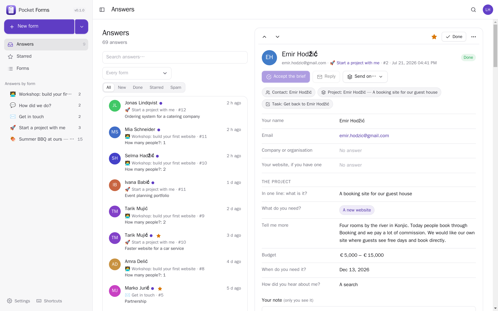
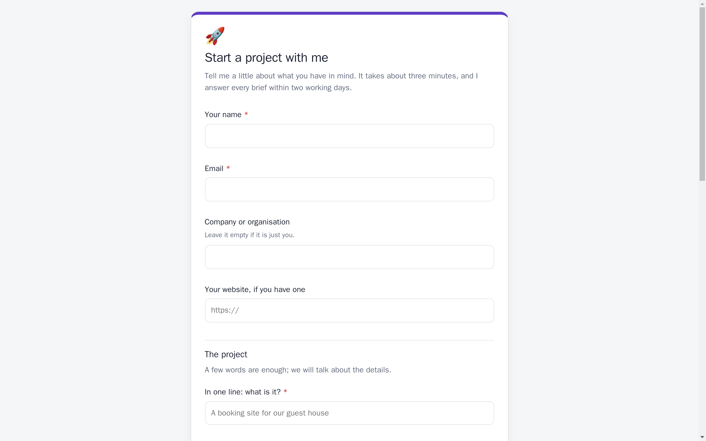
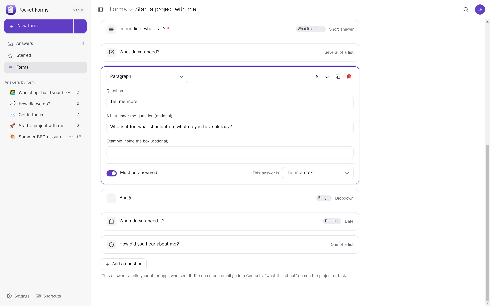
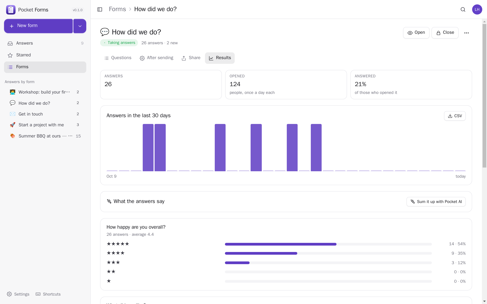
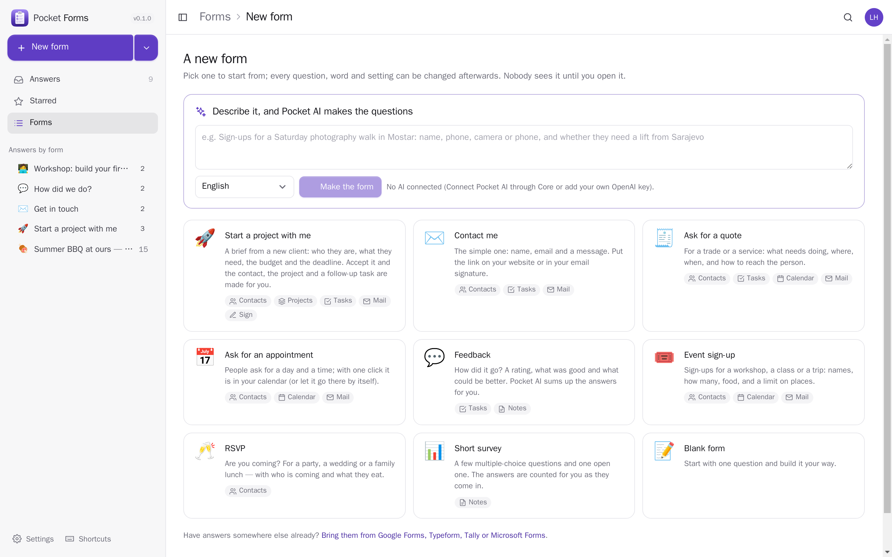
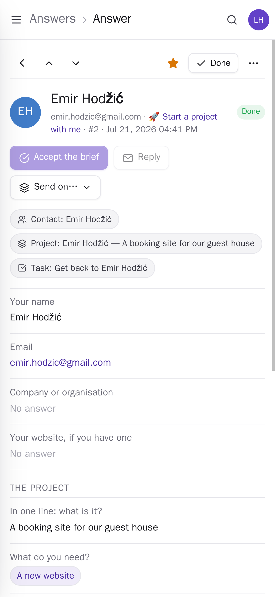
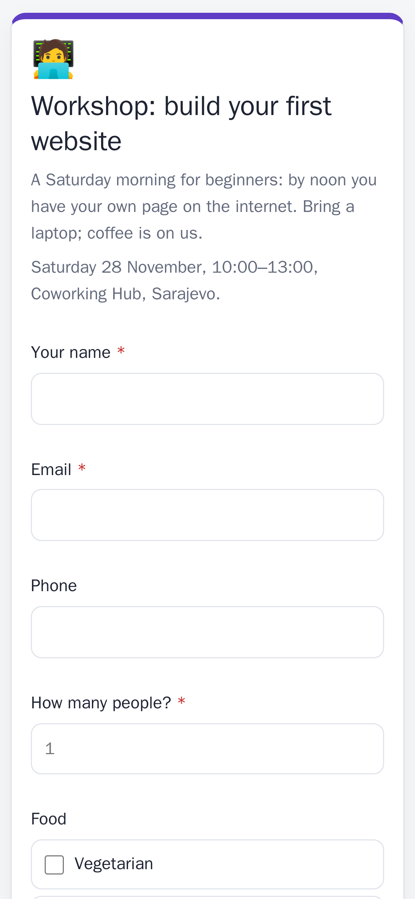

<p align="center"></p>
<h1 align="center">Pocket Forms</h1>
<p align="center">Forms and surveys anyone can fill in without an account: a brief from a new client, feedback, sign-ups for a workshop, an RSVP, a quote request. Start from a ready-made form or describe it in a sentence and let Pocket AI make the questions; share a link or put it on your website. Answers land in one inbox where one click adds the person to your contacts, starts a project, makes a follow-up task, puts the day they picked in your calendar, sends them a contract to sign or adds them to your CRM as a lead — and you reply from your own mailbox. Bring old answers from Google Forms, Typeform or Tally.<br>One Go binary, one SQLite file, one volume. Part of the Pocket apps; works on its own too.</p>
<p align="center">
  <a href="https://github.com/abjelosevic88/pocket-homelab-forms/actions"></a>
  <a href="https://github.com/abjelosevic88/pocket-homelab-forms/pkgs/container/pocket-homelab-forms"></a>
  <a href="LICENSE"></a>
</p>

---

<p align="center"></p>

<table>
  <tr>
    <td width="50%"></td>
    <td width="50%"></td>
  </tr>
  <tr>
    <td align="center"><sub>What people see: a fast page with no scripts and no account, light and dark, in five languages.</sub></td>
    <td align="center"><sub>Questions you click to edit; “This answer is” tells your other apps who sent it.</sub></td>
  </tr>
  <tr>
    <td width="50%"></td>
    <td width="50%"></td>
  </tr>
  <tr>
    <td align="center"><sub>Results: who opened it, who answered, every choice counted, and Pocket AI’s summary.</sub></td>
    <td align="center"><sub>Start from a ready-made form, or describe it to Pocket AI.</sub></td>
  </tr>
  <tr>
    <td width="50%"></td>
    <td width="50%"></td>
  </tr>
  <tr>
    <td align="center"><sub>Answers on the phone, with everything made from them.</sub></td>
    <td align="center"><sub>A workshop sign-up with a limit on places.</sub></td>
  </tr>
</table>

## What it does

- **Fifteen kinds of question**: short answer, paragraph, email, phone, number, web address, date, time, one of a list, several of a list (both with “Other”), dropdown, yes/no, stars, “I agree”, and headings between parts. Required or not, a hint under each, an example inside the box.
- **Ready-made forms**: Start a project with me (a client brief), Contact me, Ask for a quote, Ask for an appointment, Feedback, Event sign-up, RSVP, Short survey — or a blank one, or **one Pocket AI makes from a sentence**.
- **Public pages without an account**: rendered on the server with no JavaScript, phone-first, light and dark, in English, Bosnian, Croatian, Serbian or German. A hidden field and a signed, timed form keep robots out; ten answers per address every ten minutes at most. Prefill answers from the link (`?email=…`), put the form on your website in a frame, or send people to your own page afterwards.
- **Taking answers**: a draft only you can see, open, closed; a last day; at most so many answers (limited places); one answer per email.
- **One inbox** for every form: new, read, done, starred, spam; search; keyboard (j/k, e, x, r); your own note on each answer; CSV per form.
- **“This answer is”**: mark which question is the person's name, email, phone, company or website, what it is about, the main text, budget, deadline or a day for the calendar — and the rest of the box knows what to do with it.
- **Results**: who opened it (counted once a day, no cookies), who answered, every choice and star counted, the latest written answers, and Pocket AI's summary of what people say.
- **Bring answers in** from Google Forms, Typeform, Tally, Microsoft Forms or Jotform (CSV — the form is made from the first row), or a Pocket Forms export; twice is the same as once.
- **Everyone their own** on one box: each person has their own forms, answers, settings and connections; admins see no one else's answers.
- **Pushes** through Apprise, ntfy or a webhook: each new answer, and a morning note about the answers waiting.

## Run it

```sh
docker run -d --name pocket-forms -p 8080:8080 -v ./data:/data \
  -e BASE_URL=https://forms.example.com -e SECURE_COOKIES=true \
  ghcr.io/abjelosevic88/pocket-homelab-forms:latest
```

or `docker compose up -d` with [docker-compose.yml](docker-compose.yml). Open it, create the first account and make a form; people answer at `https://forms.example.com/f/<address>`. To keep the app private and put only the forms on the internet, set `PUBLIC_URL` to a second hostname that serves nothing but the form pages. All options: [docs/configuration.md](docs/configuration.md). API: [docs/api.md](docs/api.md).

## With Pocket Core

Set `CORE_URL` and `CORE_REGISTRATION_KEY` and Forms joins the box: people sign in with Pocket Core, Pocket AI helps, and through app links each person's answers go on to their own Pocket apps with nothing to paste:

| App | What an answer becomes | Scopes |
|---|---|---|
| Pocket Contacts | the person (unless their email is there already) | `contacts:read`, `contacts:write` |
| Pocket Projects | a project from a brief, the answers as its description, the deadline as its target date | `projects:read`, `projects:write` |
| Pocket Tasks | a follow-up task | `tasks:write` |
| Pocket Calendar | the day they picked | `calendar:write` |
| Pocket Notes | a note | `notes:write` |
| Pocket Mail | your reply, and a copy of their answers, from your own mailbox | `mail:send` |
| Pocket Sign | a contract from one of your templates, for them to sign | `signing:read`, `signing:write` |
| Pocket CRM | a lead (a deal) with what they asked for, their budget as its amount, their deadline as its expected close and a next step to get back to them — once per answer, however often you send it | `crm:write` |
| Pocket AI | a form from a sentence, a summary of the answers, a reply; the Ask button on every page | inference |

**Accept the brief** does the first three in one step (and, if you tick it, adds a deal to Pocket CRM). Each form can also do things **by itself** for every answer: add the person to Contacts, make a task, put the day in the Calendar, save a note, add a lead to Pocket CRM, email them a copy.

Other apps read your forms (`forms:read`: Pocket Day writes the answers that came in into your journal, Pocket Search finds them, Pocket Contacts shows a person's answers on their page, Pocket AI tells you what came in, Pocket CRM's Leads page lists the answers not yet deals) and start forms for you (`forms:write`: “make me a sign-up form for Saturday's walk” in Pocket AI — a draft for you to check, changing only the forms it made). Events on the bus — `forms.response_received` (with the answers by question), `forms.form_opened`, `forms.form_closed` — start flows in Pocket Flows. Without Core every connection can be made directly with a URL and a token; the Core-only choices stay visible, greyed out.

## Develop

```sh
make dev     # API on :8080 with demo data + Vite on :5173
make test    # go vet, go test, tsc
make         # web + binary
```

`node scripts/screenshots.mjs` takes the screenshots above from a demo instance and fails on any browser error. MIT licensed.
